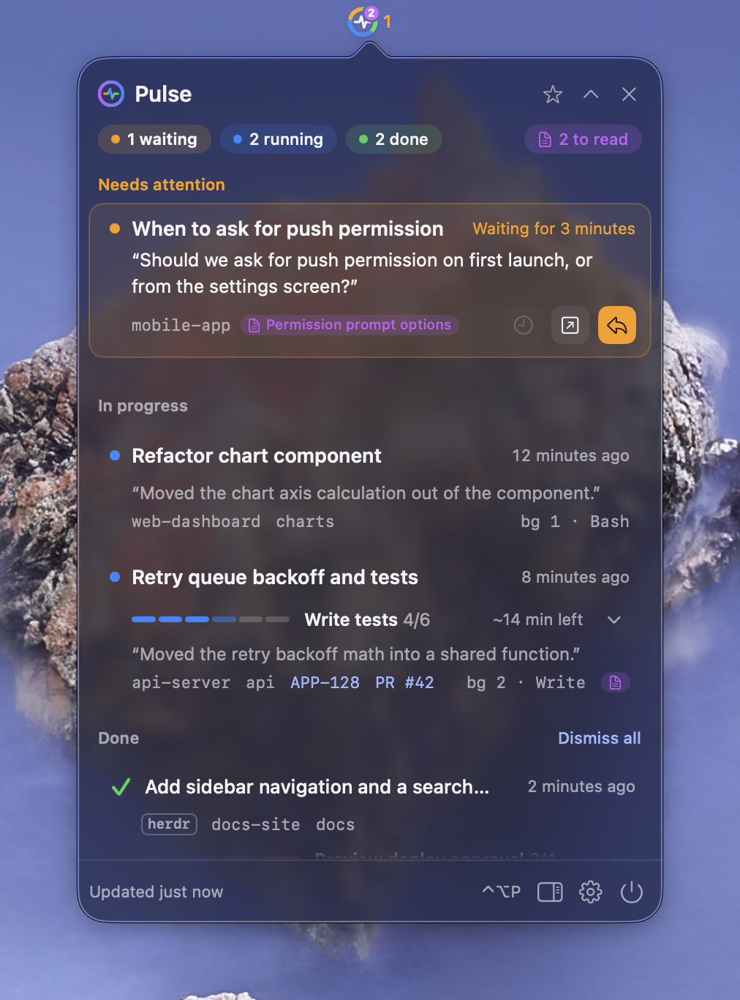
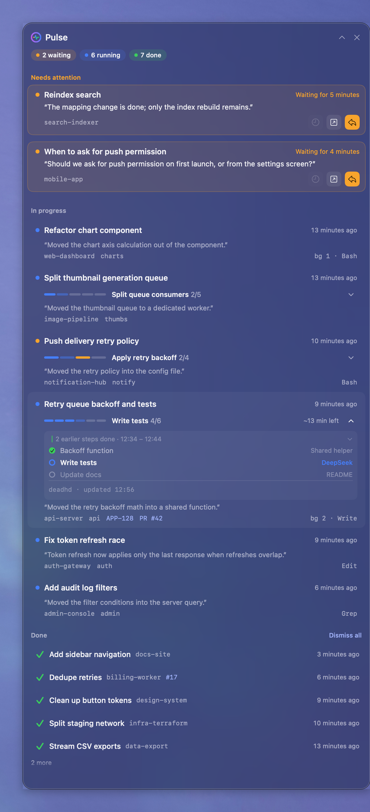
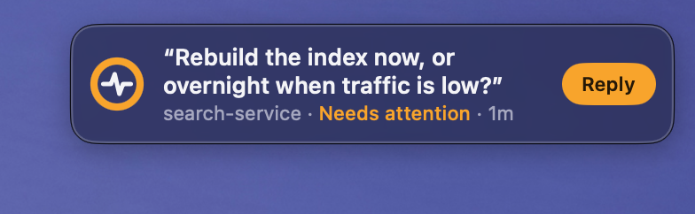
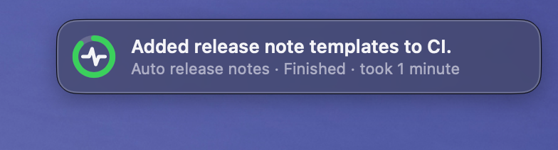
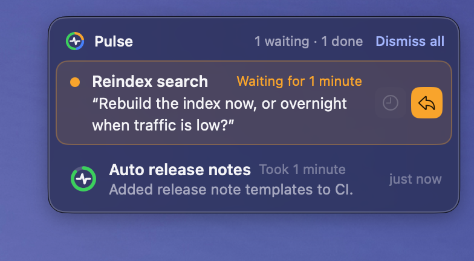
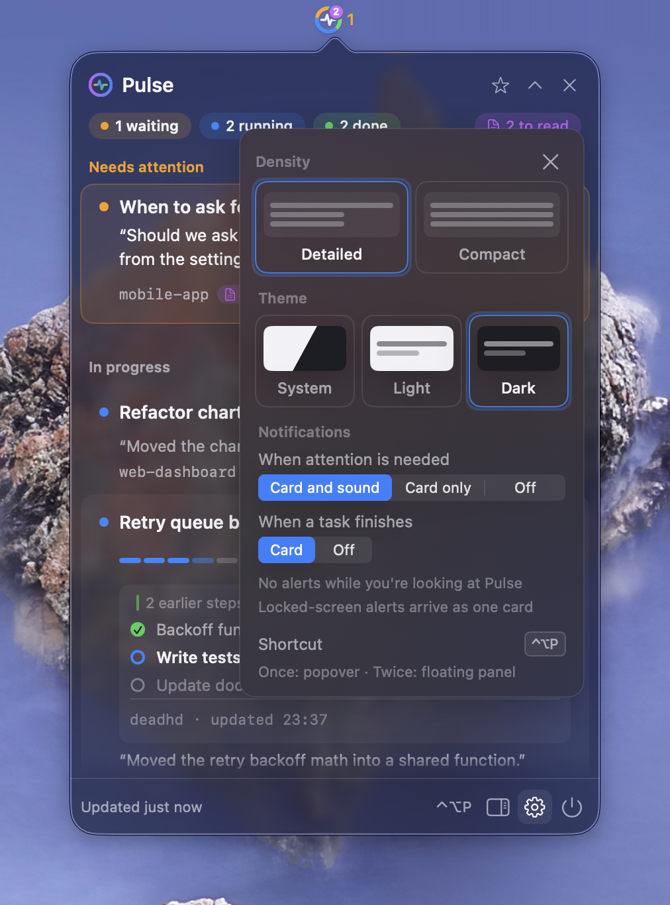
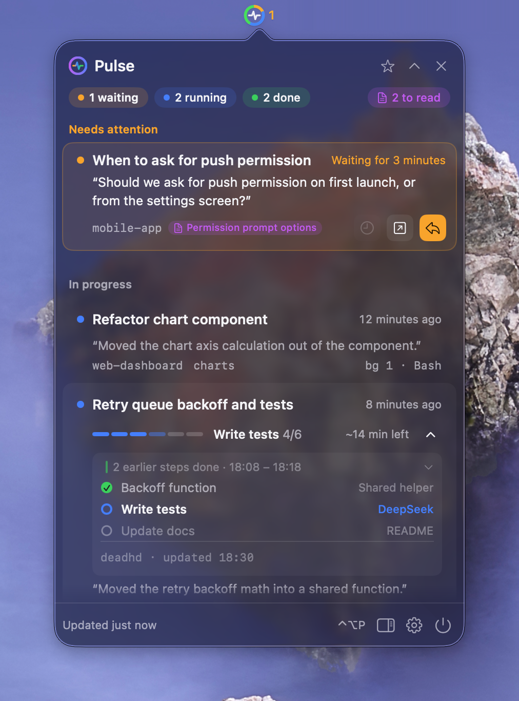

<h1 align="center">Pulse</h1>

<p align="center">See the pulse of your Claude Code sessions from the macOS menu bar.</p>

<p align="center"><a href="README.md">한국어</a> · <b>English</b></p>

<p align="center">
  <a href="https://github.com/lcalmsky/pulse/releases/latest"></a>
  
  <a href="LICENSE"></a>
</p>

<p align="center"></p>

<p align="center">
  🟠 Sessions waiting for an answer &nbsp;·&nbsp; 🔵 Sessions working &nbsp;·&nbsp; 🟢 Finished sessions<br>
  Click a row to jump straight to that session in the Orca terminal.
</p>

<br>

## Quick start

```sh
brew tap lcalmsky/pulse https://github.com/lcalmsky/pulse
brew trust lcalmsky/pulse
brew install lcalmsky/pulse/pulse
brew services start lcalmsky/pulse/pulse
```

A small ring with a heartbeat line appears in the menu bar. Click the ring or press `⌃⌥P` to open the popover.

<br>

## Features

### Menu bar icon

| What you see | Meaning |
|---|---|
| Colored segments of the ring | Share of 🟠 attention · 🔵 working · 🟢 done sessions. Empty shares leave only the track |
| Number beside the ring | Attention count in orange. When there is none, working count in gray. When both are zero, no number is drawn |
| Dimmed ring and `Read failed` | Session files could not be read |

A heartbeat line is drawn over the ring, and it is refreshed from a poll every three seconds.

### Popover

<table width="100%">
<tr>
<td width="42%" valign="top"></td>
<td valign="top">

The list is ordered **attention → working → done**.

- **Attention** shows how long it has been waiting and the last answer. The buttons are wait 10 more minutes, open, and reply
- **Working** shows a step bar, the remaining time, and what it is doing now. On hover, the progress page and go to Orca buttons appear
- **Done** shows the latest five only and folds the rest into `N more`. A line under the title shows the location, session name, ticket key, and PR, so you can tell which session it is even when the title is long. A session whose turn ended before its deadhd checklist was finished keeps a step line on its done row, and you can click it to expand the steps
- **Header and footer** the header has the three group counts and the GitHub star and collapse buttons, and the footer has the refresh time and the floating panel, settings, and quit buttons
- **Search** typing without `⌘` or `⌃` opens a search line below the header. It searches titles, worktrees and branches, working directory names, keys, ticket keys, and PR labels, and every space-separated word must be present. It also finds done items folded out of view

When there are no sessions it shows an empty state, and when sessions cannot be read it shows a `Retry now` banner.

</td>
</tr>
</table>

### Floating panel

<table width="100%">
<tr>
<td width="42%" valign="top"></td>
<td valign="top">

Keeps the same list as the popover **in a separate window.** You can drag it and resize it, and it remembers its position and size.

- Its height follows the content and, once the content exceeds 70 percent of the screen height, only the list scrolls inside
- When you set the window size yourself, it uses that height as is; only the list scrolls and the header and search bar stay at the top
- Appears on every Space
- Hide it with the close button in the header or `⌃⌥P`
- A single click or `⌃⌥P` lets you drive it from the keyboard without bringing another app forward, using the same keys as the popover. When there is no search or selection left to clear, `Esc` returns keyboard focus to the app you came from

</td>
</tr>
</table>

### Notification cards

<table width="100%">
<tr>
<td width="42%" valign="top">
<br>
<br>

</td>
<td valign="top">

Instead of macOS notification banners, **the app draws the cards itself.**

- **Attention card** shows the last answer and how long it has been waiting. Pressing `Reply` opens the Orca terminal
- **Done card** shows a one-line summary and disappears after 8 seconds. Hovering pauses it
- **Multiple cards** the header shows `N waiting · M done` and a `Dismiss all` button
- **Away** notifications from while the screen was locked are bundled into one card when you return

On macOS 26 and later it uses Liquid Glass, and on earlier versions a blur background. Cards are not shown while the popover or panel is open.

</td>
</tr>
</table>

### Settings

<table width="100%">
<tr>
<td width="42%" valign="top"></td>
<td valign="top">

Open it with the gear button or `⌘,`. Change the density, theme, and notifications here, and check the hotkey status.

| Item | Choice |
|---|---|
| Density | Detailed · Compact. Compact narrows the popover and shortens the quotes |
| Theme | System · Light · Dark. In Light, an extra light layer sits on the glass so text behind the popover does not show through |
| When attention is needed | `Card and sound` · `Card only` · `Off` |
| When a task finishes | `Card` · `Off` |
| Hotkey | `⌃⌥P`. Shown here when another app uses it |

When **Reduce transparency** is on in System Settings › Accessibility › Display, the popover and cards draw a solid background instead of glass. A note and an `Open Settings` button then appear under Theme, and the button opens that settings pane. Reduce transparency applies to the whole system, so Pulse does not turn it off for you.

<details>
<summary>Stored keys and language</summary>

- Values are stored in the UserDefaults keys `density`, `theme`, `attentionAlert`, and `doneAlert`. If the older `attentionNotifications` and `doneNotifications` keys are present and the new keys are absent, their values are migrated.
- On-screen text follows the system preferred language. English when the first preferred language starts with `en`, Korean otherwise. Override it with the `PULSE_LANG=en|ko` environment variable.

```sh
PULSE_LANG=en build/Pulse.app/Contents/MacOS/pulse &
```

</details>

</td>
</tr>
</table>

<br>

## Using it with deadhd

<table width="100%">
<tr>
<td width="42%" valign="top"></td>
<td valign="top">

[deadhd](https://github.com/lcalmsky/deadhd) is a skill that draws a checklist for a Claude Code session. Pulse reads the state file it leaves and **adds steps to working rows.**

- **Progress** draws `5/9` and a step bar. A blocked step is painted orange
- **Current step** shows the step name and `~N min left`
- **Steps** clicking the step line expands the previous, current, and next steps inside the row. On the selected row, `→` expands and pressing it again shows all steps, while `←` collapses them one at a time
- **Progress page** the document button opens the deadhd progress page in a browser. Pulse uses `render.py` and `serve.py` from `~/.claude/skills/deadhd` when deadhd is installed there, and otherwise from the install path recorded in `~/.claude/plugins/installed_plugins.json` for the deadhd plugin. If the page cannot be created or opened, a short failure notice appears at the bottom of the popover and panel
- **Activity** an activity line such as `1 compaction · 2 in background · Bash 12 seconds ago`

Sessions that do not use deadhd are missing only the checklist and step expansion.

</td>
</tr>
</table>

<br>

## Usage

### Keyboard

| Key | Action |
|---|---|
| `⌃⌥P` | Global hotkey. Opens the popover. Pressing it again while the popover is open closes it and gives the floating panel keyboard focus. When only the panel is visible it gives the panel focus, and when the panel already has the keyboard it hides the panel |
| `↑` `↓` | Move through items. Pressing past either end wraps around to the other side |
| `⌥↑` `⌥↓` | Jump to the first or last item |
| Typed characters | Typing a character without `⌘` or `⌃` in the popover or a floating panel that takes the keyboard opens a search line below the header. It searches titles, worktrees and branches, working directory names, keys, ticket keys, and PR labels |
| `→` | Expand the selected row's steps. Pressing it again shows all steps |
| `←` | Collapse the expanded steps one step at a time |
| `⌥→` | Expand the selected row's steps all the way |
| `⌥←` | Collapse the expanded steps at once |
| `↩` | Open the selected item |
| `⌥↩` | Jump straight to the Orca terminal. While `⌥` is held, rows show `→ Go to Orca` |
| `⌫` | Acknowledge. Done items are hidden, and a stall is moved to working for ten minutes. When the search line is open it deletes search text |
| `Esc` | Close the search first if it is open, then settings if they are open, otherwise close the popover |
| `⌘,` | Open and close settings |

A floating panel takes the same keys after a single click or `⌃⌥P`, without bringing another app forward. In the panel, `Esc` clears the search first, then the selection, and then returns keyboard focus to the app you came from; it does not hide the panel. When you open a session from the panel and jump to Orca, keyboard focus also moves from the panel to Orca, so you can keep typing right away.

### Opening sessions

- Clicking a row runs `orca terminal switch --terminal <handle> --json` to jump to that session's terminal and brings Orca to the front.
- The terminal handle is read from the session process's `ORCA_TERMINAL_HANDLE` environment variable, which Orca sets for processes it starts in its terminals. Even when a worktree has several Claude terminals, Pulse jumps to that session's terminal regardless of titles. If switching with that handle fails, it falls back to the search below.
- When there is no terminal handle, Pulse looks for a terminal with the same working directory and picks the one whose title matches the session name. If no title matches, it jumps when that directory has exactly one terminal, or, when there are several, when exactly one of them is running Claude. Worktrees not yet opened since Orca restarted have empty terminal titles, so they are found this way.
- When no matching terminal exists, it briefly shows `Orca has no terminal for this session` and beeps.
- The progress page button opens a browser, and PR and ticket tags open their respective links.

### Card actions

- `Reply` on an attention card always opens the Orca terminal. Stall cards show a wait 10 more minutes button on hover.
- Hovering a done card pauses the countdown and shows open and dismiss buttons.
- `Dismiss all` in the card panel acknowledges every visible done card at once and closes every card. Attention sessions stay in the list.
- `Dismiss all` in the done section of the list hides the visible done items and removes them from the count. They stay hidden across launches.
- Acknowledging done items shows a `Dismissed N finished · Undo` toast for 6 seconds.

<br>

## Installation

### Homebrew

```sh
brew tap lcalmsky/pulse https://github.com/lcalmsky/pulse
brew trust lcalmsky/pulse
brew install lcalmsky/pulse/pulse          # latest source: brew install --HEAD lcalmsky/pulse/pulse
brew services start lcalmsky/pulse/pulse
brew upgrade lcalmsky/pulse/pulse          # update
```

Homebrew's official repositories also have a cask named `pulse` for a different app, so the short name installs that app instead; these commands use the full `lcalmsky/pulse/pulse` name. Starting with Homebrew 7, a third-party tap must be trusted with `brew trust` before its formula can be loaded.

### Build from source

```sh
git clone https://github.com/lcalmsky/pulse.git
cd pulse
scripts/bundle.sh           # scripts/bundle.sh [output directory]
open build/Pulse.app
```

Pulse does not use system notifications, so it never asks for notification permission. The attention card sound (Tink) plays whether you launch the app bundle or run `.build/debug/pulse` directly, and `.build/debug/pulse --version` prints just the version. `--help` prints usage, and an unknown `--` option exits with an error instead of starting the app.

### Requirements

| Requirement | Notes |
|---|---|
| macOS 13 or later | The Liquid Glass card requires macOS 26 or later. Earlier versions draw a blur background |
| Orca (`/Applications/Orca.app`) | Optional. Without it, jumping to a terminal does not work, but the list, steps, and progress page still work |

<br>

## How it works

Every 3 seconds it reads the session files and groups them by state. Waiting for an answer or permission is **attention**, `busy` or `shell` is **working**, and `idle` is **done**. A working session with no new activity for more than 10 minutes is treated as stalled and placed in attention. A `shell` session has finished its turn while background shells keep running, so it is treated as waiting on them and the limit is extended to 60 minutes. This holds even when the line that started the shell is earlier than the last 256 KB of the transcript that Pulse reads. When the background tasks can be counted, the card reads `Background task for N minutes`.

<details>
<summary>Where it reads and the rules</summary>

- The config root is the directory named by the `CLAUDE_CONFIG_DIR` environment variable if it is set, otherwise `~/.claude`.
- The session list comes from `<config root>/sessions/<pid>.json`. Only interactive CLI sessions (whose `entrypoint` is `cli`) are included, and only while their process is alive. The `<pid>.<hash>.key` files in the same folder are not read.
- The title, last answer, last tool, compaction count, background task count, and PR link are built from the last 256 KB of the `<config root>/projects/<project>/<session>.jsonl` transcript. Background tasks count backgrounded shells, async agents, and monitors, and drop out when their completion notice arrives or `TaskStop` stops them. Completion notices that arrived mid-turn and sit only in the queue also count.
- The deadhd state file is read from `/tmp/deadhd-state/<sessionId>.json`, and `DEADHD_STATE_DIR` changes the directory.
- When a session closes and its session file disappears, it is removed from the list on the next refresh. The done list shows only items from the last 12 hours, and the view draws up to 5.
- Notifications are not sent during the first list read after launch, while the popover or floating panel is open, or while the setting is off. Sessions that were already in that state are not announced later either.
- Notification decisions, card insertion, and away transitions are written to the system log (subsystem `io.github.lcalmsky.pulse`, category `notify`).

</details>

<br>

## Development

```sh
swift build
swift run pulse-selftest    # Checks PulseCore logic. Does not use XCTest
scripts/bundle.sh
```

- **Demos** `scripts/demo.sh start` launches sessions, `fire done|attention|both` shows cards, and `stop` takes them down. `start --many` launches 15 sessions. Every example image is captured from these demos, so the project names and text on screen are made up.
- **App icon** `swift scripts/make-icon.swift` regenerates `assets/AppIcon.icns` with the same ring and waveform as the header logo, and `scripts/bundle.sh` copies it into the bundle.
- **Release** `scripts/release.sh X.Y.Z -m "<summary of changed features>"` does the version, build, checks, tag, GitHub release, and Homebrew formula update in one go. If it stopped at the step that downloads the tarball, `scripts/release.sh --formula-only X.Y.Z` redoes only the formula update. `scripts/release-selftest.sh` checks this script.
- Repository rules are in [CLAUDE.md](CLAUDE.md).

<br>

<p align="center"><a href="LICENSE">MIT</a></p>
