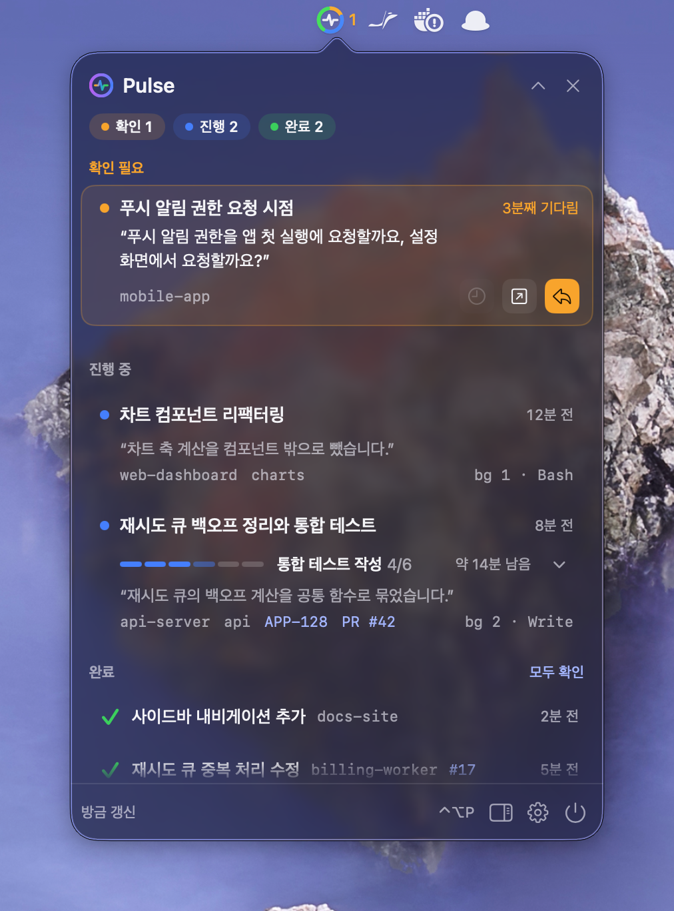
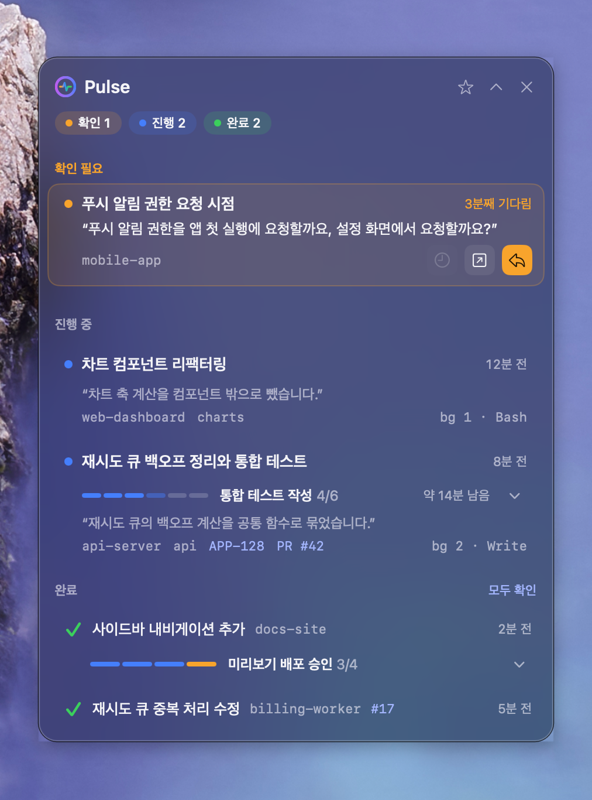
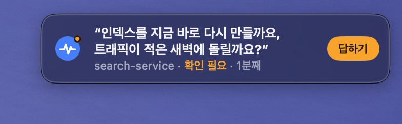
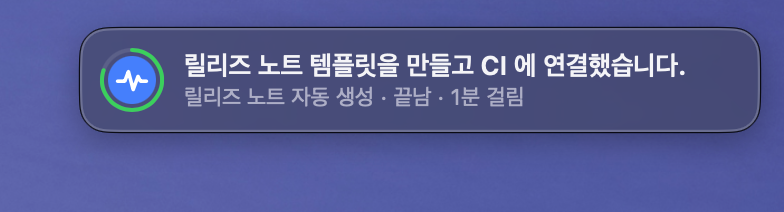
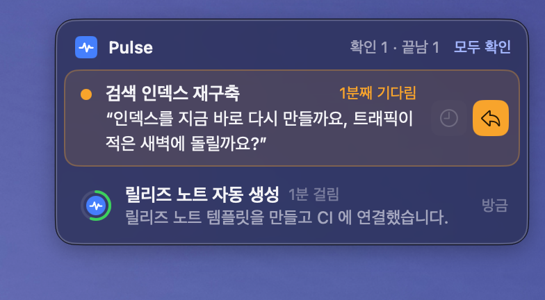
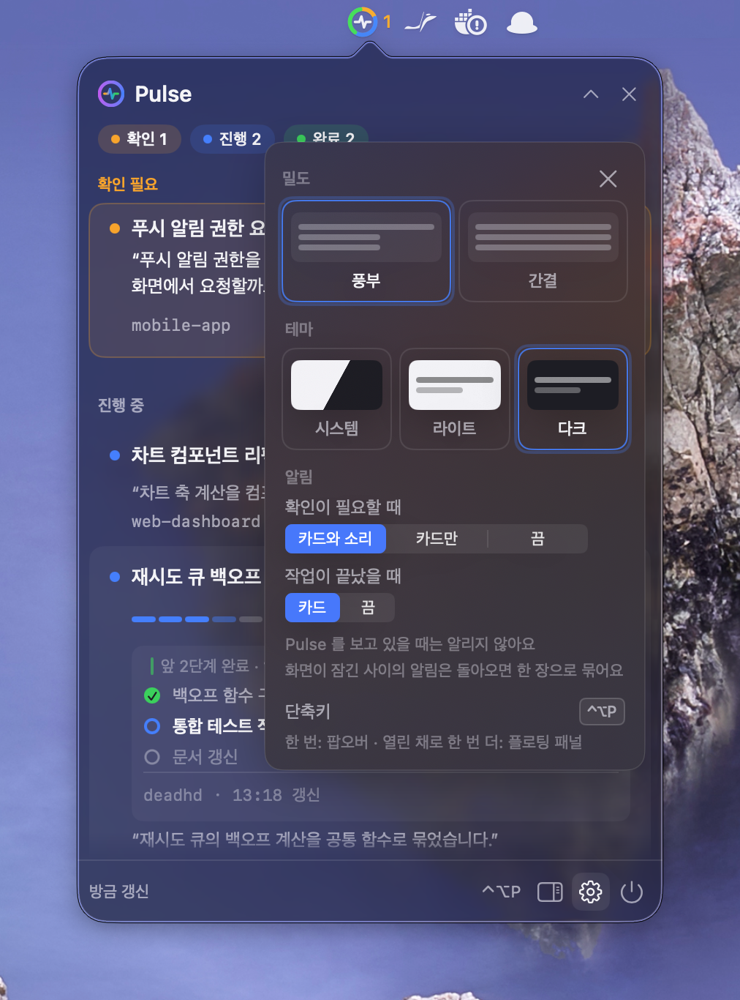
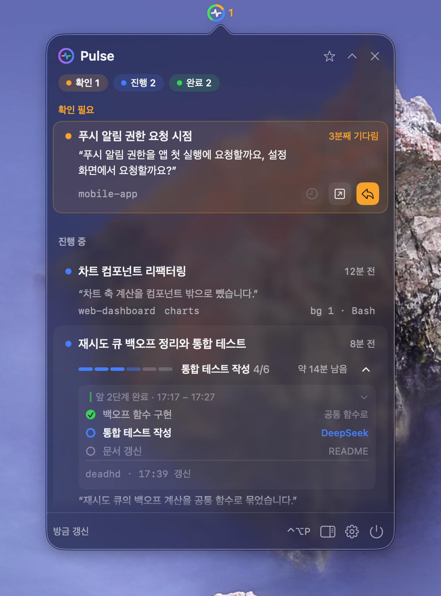

# Pulse

<p align="center"><b>한국어</b> · <a href="README.en.md">English</a></p>

Claude Code 세션의 진행 상황을 macOS 메뉴 막대와 팝오버, 알림 카드로 보여 주는 앱입니다. 세션이 답을 기다리는지, 작업 중인지, 끝났는지 한눈에 보이고, 항목을 누르면 Orca 터미널의 해당 세션으로 이동합니다.

<p align="center"></p>

## 빠른 시작

```sh
brew tap lcalmsky/pulse https://github.com/lcalmsky/pulse
brew install pulse
brew services start pulse
```

메뉴 막대에 파형을 그린 작은 링이 생깁니다. 링은 확인 필요, 진행 중, 완료 세 그룹의 비율을 나눠 칠하고, 옆에는 확인 필요가 있으면 그 수를 주황으로, 없으면 진행 중 수를 흐리게 보여 줍니다. 링을 누르면 팝오버가 열립니다.

## 기능

### 메뉴 막대 아이콘

- 링은 세션 수에 따라 확인 필요는 주황, 진행 중은 파랑, 완료는 초록 조각을 칠합니다. 비어 있는 칸이 있으면 그만큼 트랙만 남습니다.
- 링 위에는 심전도 파형을 그립니다.
- 링 옆 숫자는 확인 필요가 있으면 그 수를 주황으로, 없으면 진행 중 수를 흐린 회색으로 그립니다. 둘 다 없으면 숫자를 그리지 않습니다.
- 세션 파일을 읽지 못하면 링과 파형을 흐리게 그리고 `읽기 실패` 를 보여 줍니다.
- 3초마다 다시 읽어 아이콘을 갱신합니다.

### 팝오버


머리글에 Pulse 로고와 확인, 진행, 완료 뱃지가 있고, 접기와 닫기 버튼이 있습니다. 목록은 확인 필요, 진행 중, 완료 순서로 놓입니다. 완료는 최근 5개만 그리고 나머지는 `그 밖에 N개` 로 접습니다.

- 확인 필요 행: 주황 점과 제목, 기다린 시간(`N분째 기다림`), 마지막 답을 인용한 본문(없으면 상태 문구), 위치와 백그라운드 작업 수를 보여 줍니다. 오른쪽 버튼으로 10분 더 기다리기(stall 만), 열기, 답하기를 쓸 수 있습니다.
- 진행 중 행: 단계 막대와 지금 단계, `3/9` 위치, `약 N분 남음` 을 그리고, 그 아래에 지금 하는 일과 위치, 티켓 키, PR, 백그라운드 작업, 마지막 도구를 보여 줍니다. 마우스를 올리면 오른쪽 시간 자리가 진행 페이지와 Orca 이동 버튼으로 바뀝니다.
- 완료 행: 체크 표시와 제목, 위치, PR, 상대 시간을 보여 줍니다. 마우스를 올리면 열기와 확인 버튼이 나옵니다.
- 가운데를 접으면 머리글과 푸터만 남습니다.
- 아래 푸터에 마지막 갱신 시각, `⌃⌥P`, 플로팅 패널 버튼, 설정 버튼, 종료 버튼이 있습니다.
- 보여 줄 세션이 없으면 점이 도는 빈 화면을 그립니다. 세션을 읽지 못하면 배너에 `지금 재시도` 가 붙습니다.

### 플로팅 패널



팝오버와 같은 목록을 별도 창에 계속 띄워 둡니다. 창을 끌어 옮기고 크기를 바꿀 수 있으며, 위치와 크기를 기억합니다. 높이는 내용에 맞추고 화면 높이의 70%를 넘으면 그 안에서 스크롤합니다. 모든 Space 에서 보이고, 머리글의 닫기 버튼이나 단축키로 숨깁니다.

### 알림 카드

Pulse 는 macOS 알림 배너를 쓰지 않고 앱이 직접 카드 패널을 그립니다. 카드 패널은 macOS 26 이상에서 Liquid Glass 배경을 쓰고, 그 아래 버전에서는 블러 배경을 씁니다.

- 카드가 한 장이면 그 카드가 곧 패널입니다. 두 장 이상이면 머리글에 `확인 N · 끝남 M` 과 `모두 확인` 버튼이 붙습니다.
- 확인 필요 카드: 마지막 답의 첫 문장(없으면 상태 문구)을 따옴표로 감싸 보여 주고, 위치와 기다린 시간을 덧붙입니다. `답하기` 를 누르면 Orca 터미널이 열립니다. 세션이 확인 필요에서 벗어날 때까지 남습니다.
- 끝남 카드: 요약 한 줄과 `{세션} · 끝남 · N분 걸림` 을 보여 줍니다. 아이콘을 두른 링이 8초 동안 줄어들고 카드가 사라집니다. 마우스를 올리면 남은 시간이 멈춥니다.
- 자리 비움: 화면이 잠긴 동안 생긴 카드를 모아 두었다가 돌아오면 한 장으로 묶습니다. 막힌 세션이 있으면 `세션 N개가 기다려요`, 끝난 세션만 있으면 `세션 N개가 끝났어요` 라고 씁니다.
- 팝오버나 플로팅 패널을 보고 있으면 카드 패널을 숨깁니다.

<p>
  
  
</p>



### 설정



톱니 버튼이나 `⌘,` 로 엽니다.

- 밀도: 풍부와 간결 중에서 고릅니다. 간결은 팝오버 폭을 400에서 340으로 좁히고, 진행 행의 단계 막대를 108에서 84로 줄이며, 진행 행에서 상태 줄 아래의 활동 인용 줄을 숨깁니다. 확인 필요 행의 인용문은 6줄에서 2줄로 줄입니다.
- 테마: 시스템, 라이트, 다크 중에서 고릅니다.
- 알림: 확인이 필요할 때는 `카드와 소리`, `카드만`, `끔` 중에서, 작업이 끝났을 때는 `카드`, `끔` 중에서 고릅니다. 기본값은 `카드와 소리` 와 `카드` 입니다.
- 단축키: `⌃⌥P` 를 다른 앱이 쓰고 있으면 그 사실을 알려 줍니다.
- 화면이 잠긴 사이의 알림은 돌아오면 한 장으로 묶는다는 안내가 있습니다.

값은 UserDefaults 키 `density`, `theme`, `attentionAlert`, `doneAlert` 에 저장됩니다. 이전 키 `attentionNotifications`, `doneNotifications` 값이 남아 있으면 새 키가 없을 때 그 값을 옮겨 읽습니다.

Pulse 는 화면 문구에 시스템 선호 언어를 따릅니다. 첫 선호 언어가 `en` 으로 시작하면 영어, 그 밖에는 한국어로 보여 줍니다. 설정 시트에는 언어 항목이 없고, 환경 변수 `PULSE_LANG` 에 `en` 또는 `ko` 를 넣어 덮어쓸 수 있습니다. 번들 앱을 그 언어로 띄우려면 `PULSE_LANG=en build/Pulse.app/Contents/MacOS/pulse &` 처럼 실행합니다.

## deadhd 와 함께 쓰기

[deadhd](https://github.com/lcalmsky/deadhd) 는 Claude Code 세션의 체크리스트를 그리는 스킬입니다. Pulse 는 deadhd 가 세션마다 남기는 상태 파일을 읽어 진행 행에 단계 정보를 덧붙입니다.

- 진행률: `5/9` 와 단계 막대를 그립니다. 막힌 단계가 있으면 확인 필요 색으로 칠하고, 상태 파일이 30분 넘게 갱신되지 않았으면 진행률을 흐리게 그립니다.
- 지금 단계: `▶ 지금 단계` 와 `약 N분 남음` 을 보여 줍니다.
- 단계 펼침: 진행 행의 단계 줄을 누르면 직전 완료, 지금, 다음 세 단계를 행 안에 펼칩니다. 창 밖에 막힌 단계가 있으면 그 단계가 창에 들어오고, `앞 N단계` 를 누르면 전체 단계를 봅니다.
- 진행 페이지: 마우스를 올렸을 때 나오는 문서 버튼으로 deadhd 진행 페이지를 브라우저에서 엽니다. deadhd 의 `serve.py` 가 준 로컬 주소를 먼저 쓰고, 서버를 띄우지 못하면 `file://` 로 엽니다. HTML 이 아직 없으면 `render.py` 로 한 번 만듭니다.
- 활동: 상태 파일과 트랜스크립트에서 `압축 1 · 백그라운드 2 · Bash 12초 전` 같은 활동 줄을 만듭니다.

deadhd 를 쓰지 않는 세션도 트랜스크립트만으로 제목, 마지막 답, 지금 실행 중인 도구를 보여 줍니다. 이때는 체크리스트와 단계 펼침이 없습니다.



## 설치

### Homebrew

```sh
brew tap lcalmsky/pulse https://github.com/lcalmsky/pulse
brew install pulse
brew services start pulse
```

최신 소스를 쓰려면 `brew install --HEAD pulse` 로 설치합니다. 업데이트는 `brew upgrade pulse` 입니다.

### 소스에서 빌드

```sh
git clone https://github.com/lcalmsky/pulse.git
cd pulse
scripts/bundle.sh
open build/Pulse.app
```

`scripts/bundle.sh [출력 디렉터리]` 로 번들을 만들 위치를 바꿀 수 있습니다. Pulse 는 시스템 알림을 쓰지 않아 알림 권한을 묻지 않고, 확인 필요 카드 소리(Tink)는 앱 번들로 띄우든 `.build/debug/pulse` 실행 파일을 그대로 띄우든 울립니다. `.build/debug/pulse --version` 처럼 버전만 확인할 수도 있습니다.

### 필요 조건

- macOS 13 이상
- Liquid Glass 카드 패널은 macOS 26 이상에서 동작합니다. 그 아래 버전에서는 블러 배경으로 그립니다.
- Orca(`/Applications/Orca.app`)는 선택입니다. Orca 가 없으면 터미널 이동만 할 수 없고 목록과 단계, 진행 페이지는 그대로 보입니다.

## 사용법

### 키보드

`⌃⌥P` 는 어느 앱이 앞에 있든 동작하는 전역 단축키입니다. 팝오버가 닫혀 있고 패널도 없으면 팝오버를 열고, 팝오버가 열려 있으면 팝오버를 닫고 플로팅 패널이 없을 때 패널을 띄웁니다. 팝오버가 닫힌 채 패널만 떠 있으면 패널을 숨깁니다. 다른 앱이 같은 단축키를 쓰고 있으면 등록되지 않고 설정 시트에 그 사실이 표시됩니다.

팝오버가 열려 있을 때 다음 키를 씁니다. 이동할 수 없는 행은 선택에서 건너뜁니다.

- `↑`/`↓`: 현재 목록의 항목을 오갑니다. 아무것도 고르지 않은 상태에서는 `↓` 가 처음, `↑` 가 마지막부터 시작하고, 끝에서 한 번 더 누르면 반대편으로 돌아갑니다.
- `↩`: 고른 항목을 엽니다.
- `⌥↩`: 터미널 핸들이나 작업 디렉터리가 있는 행에서 Orca 터미널로 바로 이동합니다. `⌥` 를 누르고 있는 동안 팝오버의 진행 중·완료 행에는 `→ Orca 로 이동` 이 표시됩니다. 확인 필요 카드와 플로팅 패널에는 표시되지 않습니다.
- `⌫`: 고른 항목을 확인 처리합니다. 완료 항목은 숨기고, stall 상태의 확인 필요 항목은 10분 동안 진행 중으로 내립니다.
- `Esc`: 설정이 열려 있으면 설정을 닫고, 아니면 팝오버를 닫습니다.
- `⌘,`: 설정을 열고 닫습니다. 설정이 열려 있는 동안에는 목록 단축키가 목록에 전달되지 않습니다.

### 세션 열기

- 행을 누르면 `orca terminal switch --terminal <handle> --json` 으로 그 세션의 터미널로 이동하고 Orca 를 앞으로 가져옵니다.
- 터미널 핸들이 없는 세션은 작업 디렉터리가 같은 터미널을 찾습니다. 같은 폴더에 여럿이면 세션 이름과 터미널 제목이 같은 것을, 그래도 없으면 가장 최근에 출력이 있던 것을 고릅니다.
- 맞는 터미널이 없으면 `Orca 에 이 세션의 터미널이 없어요` 를 잠깐 보여 주고 비프음을 냅니다.
- `답하기` 버튼도 같은 방식으로 Orca 터미널을 엽니다.
- 진행 페이지 버튼은 브라우저를 열고, PR 과 티켓 태그는 각각 링크를 엽니다.

### 카드 동작

- 확인 필요 카드에 마우스를 올리면 stall 카드에 한해 10분 더 기다리기 버튼이 나옵니다. `답하기` 는 언제나 Orca 터미널을 엽니다.
- 끝남 카드에 마우스를 올리면 시간이 멈추고 열기와 확인 버튼이 나옵니다.
- 카드 패널의 `모두 확인` 은 떠 있는 끝남 카드를 한꺼번에 확인 처리하고, 카드 패널에 뜬 카드를 확인 필요 카드까지 모두 닫습니다. 확인 필요 세션은 목록에 그대로 남습니다.
- 목록의 완료 섹션에서 `모두 확인` 을 누르면 지금 보이는 완료 항목을 숨기고 개수에서도 뺍니다. 확인한 완료는 앱을 다시 켜도 숨김 상태로 남습니다.
- 완료를 확인하면 팝오버 아래에 `완료 N개를 확인했어요 · 되돌리기` 토스트가 6초 동안 뜹니다. 그동안 되돌리기를 누르면 방금 확인한 항목이 다시 보입니다.
- stall 카드의 10분 더 기다리기는 그 세션을 10분 동안 확인 필요에서 진행 중으로 내립니다.

## 동작 방식

- 3초마다 세션 파일을 읽습니다. 읽는 곳은 `CLAUDE_CONFIG_DIR` 환경 변수가 있으면 그 디렉터리, 없으면 `~/.claude` 아래입니다.
- 세션 목록은 `<설정 루트>/sessions/<pid>.json` 에서 읽습니다. 대화형 CLI 세션(`entrypoint` 가 `cli`)만 올리고, 프로세스가 살아 있는 세션만 남깁니다. 같은 폴더의 `<pid>.<hash>.key` 는 읽지 않습니다.
- 제목과 마지막 답, 마지막 도구, 압축 수, 백그라운드 작업 수, PR 링크는 `<설정 루트>/projects/<프로젝트>/<세션>.jsonl` 트랜스크립트의 마지막 256KB 에서 만듭니다.
- deadhd 상태 파일은 `/tmp/deadhd-state/<sessionId>.json` 에서 읽고, `DEADHD_STATE_DIR` 로 디렉터리를 바꿀 수 있습니다.
- 그룹은 세션 상태로 나눕니다. 답이나 권한을 기다리는 세션은 확인 필요, `busy` 나 `shell` 세션은 진행 중, `idle` 세션은 완료입니다. `busy` 나 `shell` 인데 10분 넘게 새 활동이 없으면 stall 로 보고 확인 필요에 둡니다.
- 사라진 세션은 12시간 동안 완료로 남깁니다. 완료 목록은 최근 12시간 안의 항목만 보여 주고, 화면에는 5개까지 그립니다.
- 알림은 앱을 켜고 처음 읽은 목록, 팝오버나 플로팅 패널이 열려 있는 동안, 설정이 꺼져 있는 동안에는 보내지 않습니다. 그 상태로 남아 있던 세션은 나중에도 알리지 않습니다.
- 알림 판정과 카드 삽입, 자리 비움 전환은 시스템 로그(subsystem `io.github.lcalmsky.pulse`, category `notify`)에 남습니다.

## 개발

```bash
swift build
swift run pulse-selftest
scripts/bundle.sh
```

- `swift run pulse-selftest` 는 문구, 그룹 판정, 설정 이행 같은 PulseCore 로직을 검사합니다. XCTest 는 쓰지 않습니다.
- 데모 세션은 `scripts/demo.sh start` 로 띄우고 `scripts/demo.sh fire done|attention|both` 로 카드를 띄우며 `scripts/demo.sh stop` 으로 내립니다. `start --many` 는 플로팅 패널 그림용으로 세션 15개를 띄웁니다. 예시 그림은 모두 이 데모로 찍은 것이라 화면의 프로젝트 이름과 문구는 가짜입니다.
- 릴리즈는 `scripts/release.sh X.Y.Z -m "<바뀐 기능 요약>"` 로 합니다. 버전, 빌드, 검사, 태그, GitHub Release, Homebrew formula 갱신을 한 번에 합니다.
- 저장소 규칙은 [CLAUDE.md](CLAUDE.md) 에 있습니다.

## 라이선스

[MIT](LICENSE)
